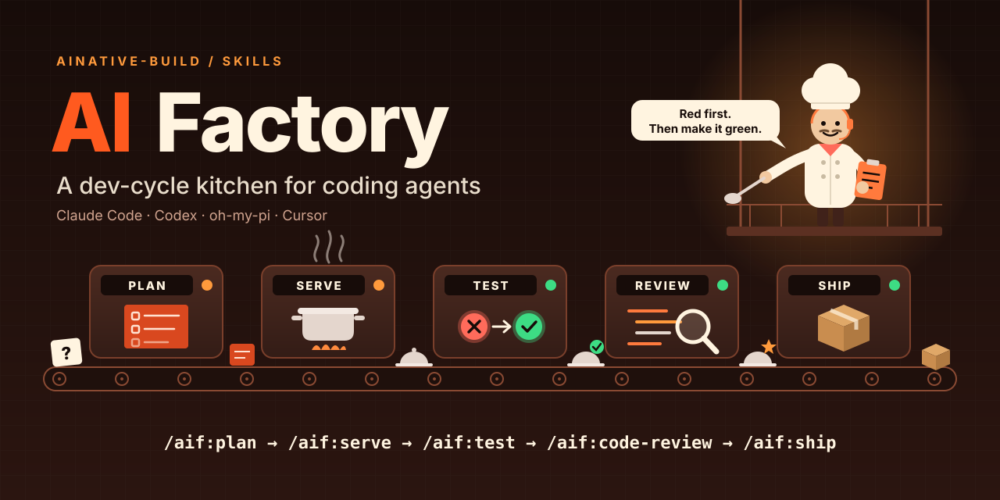
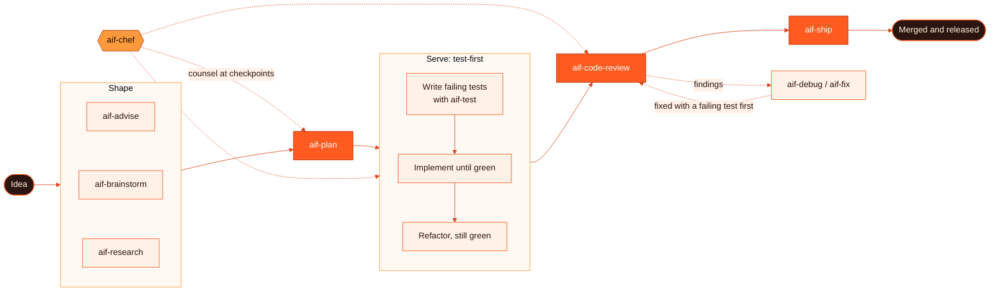
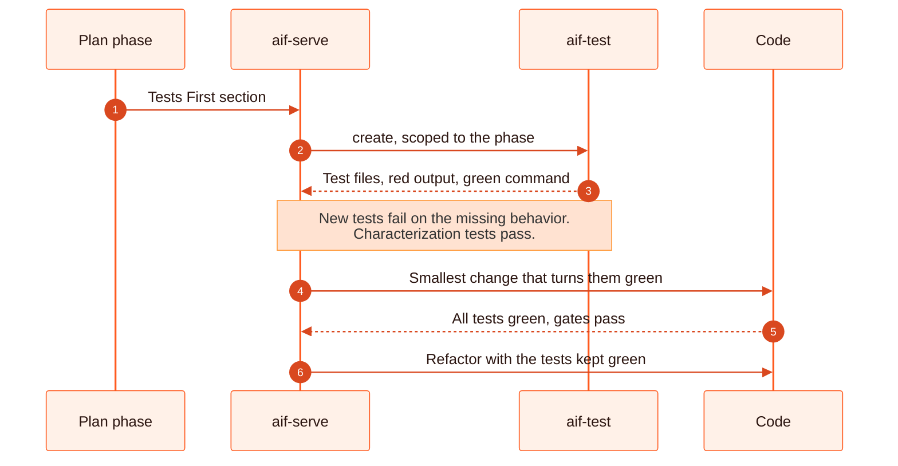
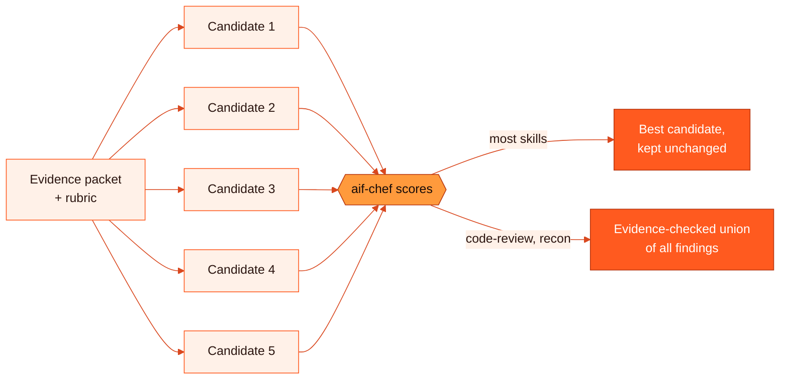

<p align="center">
  
</p>

<p align="center">
  <a href="https://github.com/ainative-build/skills/releases/latest"></a>
  <a href="./LICENSE"></a>
  
  
</p>

<p align="center">
  <b>Development-cycle skills, agents, rules and hooks for coding agents.</b><br>
  One source tree runs on Claude Code, Codex, oh-my-pi (OMP) and Cursor. It is self-contained,
  with no other CLI or service to install.
</p>

<p align="center">
  <a href="#how-the-kitchen-runs">How it runs</a> ·
  <a href="#quick-start">Quick start</a> ·
  <a href="#the-menu-skills-by-station">Skills</a> ·
  <a href="#test-first-every-time">Test-first</a> ·
  <a href="#pro-max-mode---pro-max">Pro-max</a> ·
  <a href="#chef-mode---chef">Chef</a> ·
  <a href="#the-crew-agents">Agents</a> ·
  <a href="#install">Install</a>
</p>

---

## How the kitchen runs

Work moves down one line, from a raw idea to a shipped change. Each station is a skill, and
`aif-chef` watches from the catwalk when you ask it to.



## Quick start

```
/plugin marketplace add ainative-build/skills
/plugin install aif@ainative-build
```

Then cook something (on the plugin, type `:` for `-`, as in `/aif:brainstorm`):

```
/aif-brainstorm add rate limiting to the public API
/aif-plan add rate limiting to the public API
/aif-serve .aif/plans/261022-1320-rate-limit
/aif-code-review --pending
/aif-ship
```

Other runtimes and the skills-only install are under [Install](#install).

## The menu: skills by station

Every skill has a command, written `/aif-<name>` throughout these docs. On the Claude Code plugin,
plugin commands take a colon, so type `/aif:<name>` there (for example `/aif:plan`).

| Station | Skill | What it does |
|---|---|---|
| 🧭 **Shape** | `aif-advise` | Interviews until the outcome is clear, then gives evidence-backed advice. |
| | `aif-brainstorm` | Turns unclear intent into an accepted outcome and compares approaches. |
| | `aif-research` | Researches technologies, architectures and requirements. |
| 📋 **Plan** | `aif-plan` | Writes phased, test-first plans with acceptance criteria. Also has validate, red-team and archive modes. |
| 🍳 **Build** | `aif-serve` | Implements a plan or feature end to end: tests first, then code, verification and review. |
| | `aif-recon` | Maps the files, callers and tests a task touches. |
| 🩺 **Fix** | `aif-debug` | Proves the root cause of a failure before any fix. |
| | `aif-fix` | Fixes bugs and test, type, lint and CI failures with routed workflows. |
| 🧪 **Verify** | `aif-test` | Designs and runs test suites. Has create, audit and optimize modes. |
| | `aif-web-testing` | Playwright, Vitest and k6 patterns for web apps. |
| | `aif-agent-browser` | Drives a tool-managed browser for snapshots, forms and UI checks. |
| | `aif-chrome-profile` | Drives your real Chrome profile through Chrome DevTools MCP. |
| 🔍 **Review** | `aif-code-review` | Reviews changes, a PR, a commit or the whole codebase, with evidence. |
| 📦 **Ship** | `aif-git` | Conventional commits, branches, PRs and merges, with secret scanning. |
| | `aif-ship` | Takes a finished branch through tests, review, PR, merge and release. |
| 🧠 **Think** | `aif-problem-solving` | Techniques for getting unstuck. |
| | `aif-deep-thinking` | A disciplined reasoning protocol for hard problems. |
| 🎞️ **Media** | `aif-ai-multimodal` | Analyzes and generates images, audio, video and documents. |

## Test-first, every time

Every plan phase has a **Tests First** section:
- characterization tests for behavior that must not change;
- new-behavior tests, each naming the failure it should show before the code exists;
- the commands that run the tests red first and green after.

`/aif-serve` hands that section to `aif-test` before it writes any production code.



A test that fails on an import or setup error isn't red for the right reason, so serve fixes the
test before implementing. Pass `--no-test` to skip all this; serve reports the gap. A phase with
nothing testable says `Tests First: not applicable` and gives the reason.

## Everything lands in `.aif/`

```
your-project/
└── .aif/
    ├── config.json          optional project settings (docs/aif-config.md)
    ├── plans/
    │   └── 261022-1320-rate-limit/
    │       ├── plan.md      status, phases, acceptance criteria
    │       └── phase-01-….md
    └── reports/             brainstorm, research, debug, review and test reports
```

User-wide settings live in `~/.aif/config.json`, or in `$AIF_HOME/config.json` when `AIF_HOME`
is set. Local plan state (`plans-state.json`) sits beside them.

Skills write reports as they run, and `/aif-ship` commits the reports the shipped work produced.
Add `.aif/reports/` to `.gitignore` if you would rather keep them out of git.

One thing lands outside `.aif/`. The aif agents use Claude Code's project memory (`memory:
project`), so Claude Code keeps their notes in `.claude/agent-memory/<agent>/`, for example
`.claude/agent-memory/aif-aif-code-reviewer/`. Commit it to share what the agents learn, or
ignore it.

## Pro-max mode (`--pro-max`)

`--pro-max` trades cost for quality on work with a checkable outcome. The skill builds one
evidence packet and one scoring rubric and sends them to five independent read-only candidates
in parallel. `aif-chef`, on the strongest model, then scores the five.



| Rule | What it means |
|---|---|
| **Winner selection** | brainstorm, plan, advise, research, debug, fix, problem-solving and test keep the single best candidate. They never blend candidates, because a blend is not what the verifier checked. |
| **Union** | code-review and recon keep the deduplicated union of findings that check out against the evidence, so a catch made by only one candidate is not lost. |
| **Fails closed** | Pro-max needs parallel subagents and stops on a runtime without them. If fewer than five candidates are usable after one retry, or chef rejects them all, nothing is written. |
| **Receipt** | Each run adds a one-line `pro-max:` receipt to its report or plan, naming the pick and its margin. |

Use it where checking an answer is easier than producing one, such as a plan against acceptance
criteria or a review against evidence.

```
/aif-plan add rate limiting to the public API --pro-max
```

## Chef mode (`--chef`)

`--chef` runs a workflow under the supervision of `aif-chef`, which gives one-shot counsel from
the strongest model available. Chef only advises: it never writes code, edits files or overrides
a gate. The main agent stays responsible for every decision.

| Chef steps in… | |
|---|---|
| After each phase or decision round | to check direction before the next one starts |
| When work is stuck after repeated failures | instead of retrying the same fix |
| Before a high-stakes or irreversible step | such as a public-contract change |
| Once a PR's required checks are green | to post its assessment and next steps on the PR |

- `--chef` is passed on to the next skill in the chain. These skills support it: brainstorm,
  plan, serve, fix, test, code-review and ship.
- `/aif-plan --chef` writes a handover plan that a smaller model can follow, with step-by-step
  tasks, mechanical pass conditions and a failure protocol that stops and asks chef.

| Runtime | Chef runs on |
|---|---|
| Claude Code | Fable |
| Cursor | `claude-fable-5-high` |
| OMP | the `@advisor` model role |
| Codex | `gpt-6-astra`. When an account refuses it, chef falls back through `gpt-6-sol` → `gpt-5.6-sol` → `gpt-6-terra` → `gpt-5.6-terra` → `gpt-6-luna` → `gpt-5.6-luna` and says which model answered. |

```
/aif-serve .aif/plans/261022-1320-rate-limit --chef
```

## The crew: agents

Each agent is pinned to a model that fits its job. On Codex, every agent uses the same fallback
chain as chef when a model is refused. Full per-runtime models, including OMP and Cursor, are in
[`agents/runtime-models.json`](agents/runtime-models.json).

| Agent | Job | Claude Code | Codex |
|---|---|---|---|
| `aif-chef` | One-shot counsel on hard calls; scores pro-max candidates | fable | `gpt-6-astra` low |
| `aif-advisor` | Interview-driven advice | fable | `gpt-6-astra` low |
| `aif-planner` | Researches and writes implementation plans | opus | `gpt-6-sol` high |
| `aif-researcher` | Technical research reports | opus | `gpt-6-sol` high |
| `aif-debugger` | Root-cause investigation | opus | `gpt-6-sol` high |
| `aif-code-reviewer` | Evidence-backed code review | opus | `gpt-6-sol` high |
| `aif-fullstack-developer` | Implements plan phases, including in parallel | opus | `gpt-6-sol` high |
| `aif-ui-ux-designer` | Interface and design work | opus | `gpt-6-sol` high |
| `aif-code-simplifier` | Refines code without changing behavior | opus | `gpt-5.6-luna` high |
| `aif-docs-manager` | Keeps project docs accurate | opus | `gpt-5.6-luna` high |
| `aif-tester` | Runs and checks test suites | haiku | `gpt-5.6-luna` medium |
| `aif-recon` | Finds the files a task touches | haiku | `gpt-5.6-luna` low |
| `aif-explore` | Fast codebase scans | haiku | `gpt-5.6-luna` low |
| `aif-git-manager` | Commits and pushes | haiku | `gpt-5.6-luna` low |

## Rules and hooks

| 9 rules (`rules/`) | 6 hooks (`hooks/`) |
|---|---|
| Development rules | Session context: where plans, reports and docs go |
| Workflow routing and skill routing | Subagent context, named for the delegate's reports |
| Orchestration, with the Codex model fallback | Development-rules reminder on each prompt |
| Documentation management | Privacy guard for secrets files |
| Review, audit and decision rules | Scout guard against broad scans |
| Process management | Secret-output reminder |
| Primary workflow and the hook response protocol | |

## Install

Skills install through skills.sh or the Claude Code plugin. Agents, rules and hooks come with the
plugin on Claude Code, and from `aif-install` everywhere else.

| You want | Run |
|---|---|
| Skills only, on any runtime | `npx skills@latest add ainative-build/skills` |
| Everything on Claude Code | `/plugin marketplace add ainative-build/skills`, then `/plugin install aif@ainative-build` |
| Agents, rules and hooks without the plugin | `npx -p github:ainative-build/skills aif-install --runtime codex` |

- **`--runtime`** takes `claude`, `codex`, `omp`, `cursor` or `all`.
- **`--dry-run`** lists the files first, and **`--uninstall`** removes everything the installer
  added.
- **Safe edits:** the installer backs up each file it edits and never touches entries it did not
  write. It records what it owns in `~/.aif/install-manifest.json`.
- **Claude Code:** use either the plugin or `aif-install --runtime claude`, not both, because both
  register the same hooks.
- **Codex:** it runs new hooks only after you approve them, so start `codex` once after installing
  and approve the aif hooks.

### Runtime support

| | Claude Code | Codex | OMP | Cursor |
|---|:-:|:-:|:-:|:-:|
| Skills | ✅ | ✅ | ✅ | ✅ |
| Agents | ✅ | ✅ TOML | ✅ model roles | ✅ |
| Rules | ✅ | ✅ inlined in `AGENTS.md` | ✅ | ✅ `.mdc` |
| Context hooks | ✅ | ✅ | — | session start only |
| Privacy and scout guards | ✅ | ✅ | — | ✅ via `cursor-adapter.cjs` |

OMP has no hooks. Cursor can't add context when a prompt is submitted or a subagent starts, so it
gets the rules through `.mdc` files instead of the reminder hook.

## Configuration

Plans, reports, language and per-hook switches live in an optional `.aif/config.json`. See
[docs/aif-config.md](docs/aif-config.md).

## Upgrading

<details>
<summary><b>From v2.0 to v2.1</b> (breaking)</summary>

- **Journal removed:**
  - The `aif-journal` skill, the `aif-journal-writer` agent and `/aif-journal` are gone.
  - Rerunning `aif-install` removes the old agent.
  - A skills.sh install leaves the old skill in place; remove it with
    `npx skills remove -g aif-journal`.
- **Output moves to `.aif/`:**
  - Plans go to `.aif/plans/` and reports to `.aif/reports/`.
  - Config moves to `.aif/config.json`, and user config to `~/.aif/config.json`.
  - `.aif.json`, `~/.aif.json` and the `journal.*` settings are no longer read, so move existing
    plans and config by hand.
- **Test-first by default:** every plan phase has a Tests First section, and `/aif-serve` writes
  failing tests before it implements. The `--tdd` flag is removed.

</details>

<details>
<summary><b>From v1 to v2</b> (breaking)</summary>

- **Replaced:**
  - The v1 skills `aif-code-review`, `aif-recon` and `aif-improve` are replaced, along with the
    v1 `code-reviewer` agent.
  - `aif-code-review` and `aif-recon` are new skills under the same names.
  - `aif-improve` is gone.
- **skills.sh:** an install of v2 updates `aif-code-review` and `aif-recon` but leaves the old
  `aif-improve` in place. Remove it with `npx skills remove -g aif-improve`.
- **Still available:** the v1 tree is at the
  [`v1.3.1`](https://github.com/ainative-build/skills/tree/v1.3.1) tag.

</details>

## License

MIT © 2026 ainative-build; see [LICENSE](./LICENSE). These parts keep their own licenses:

- `skills/engineering/aif-agent-browser/` and `skills/engineering/aif-web-testing/` are licensed
  under Apache-2.0; the full text is in each directory's `LICENSE`. They were modified for this
  repo: renamed to `aif-*`, with references to removed skills and runtime metadata deleted.
- `skills/engineering/aif-chrome-profile/` is MIT, Copyright (c) 2026 chrome-profile-cdp
  contributors; see that directory's `LICENSE`.
- `hooks/scout-block/third-party/ignore.cjs` is
  [ignore](https://github.com/kaelzhang/node-ignore) v5.3.0, MIT, Copyright (c) 2013 Kael Zhang.
